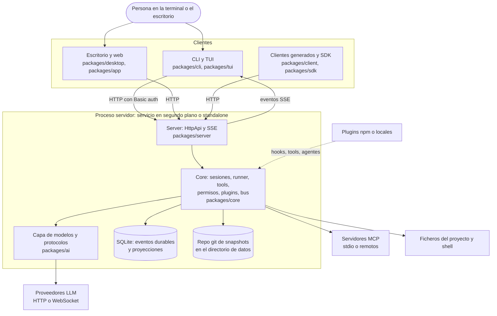
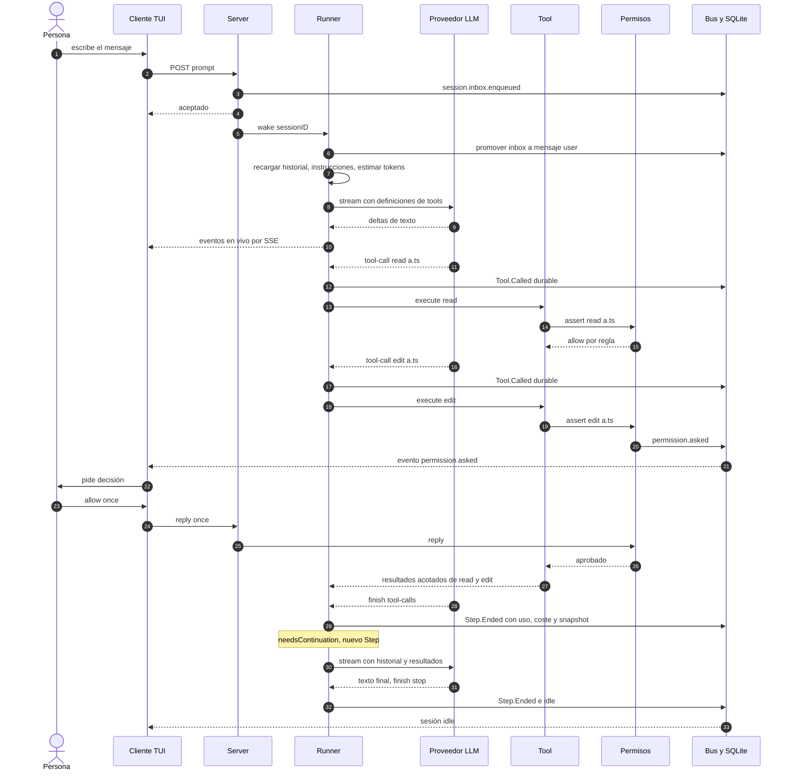
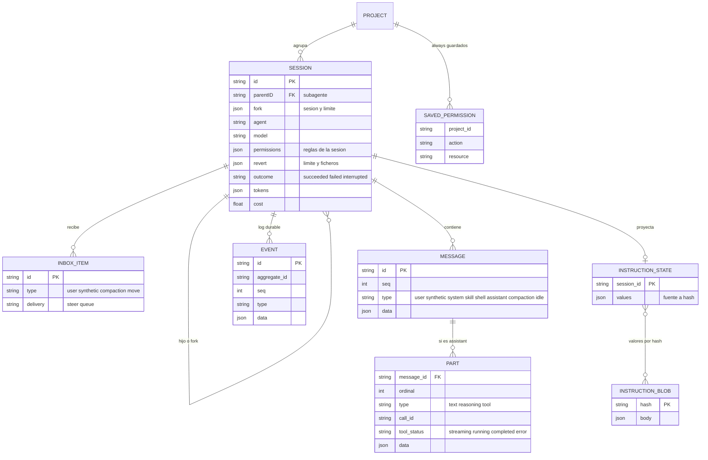
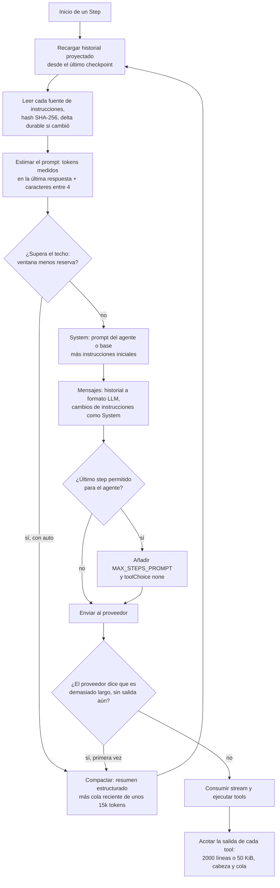
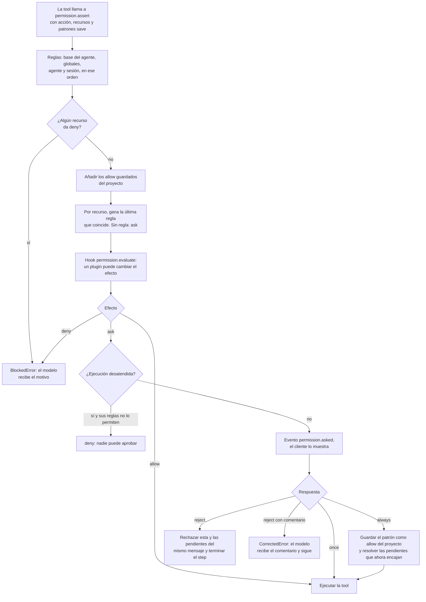
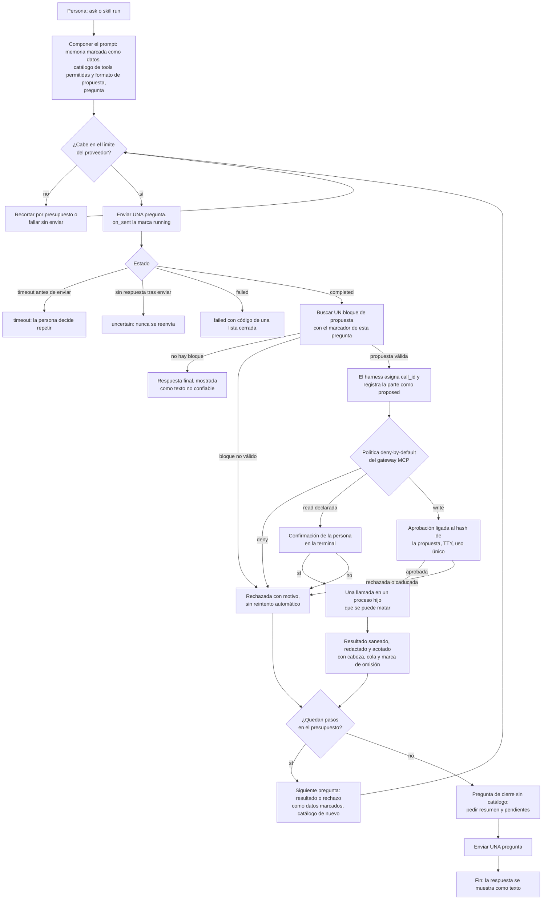

# OpenCode por dentro: qué puede aprender `ai-harness`

Estudio de arquitectura, no de uso. Fecha de consulta: 2026-11-25.

**Versión estudiada:** OpenCode **v2.4.1**, etiqueta `v2.4.1`, commit `6f0514052a3c859894ad01bb14cc14dda1e44b96` (2026-11-23, rama `dev`), clonado en superficial y leído en local. `package.json`, `packages/core/package.json` y `packages/cli/package.json` dicen `2.4.1`. Para comparar con la línea 1.x se consultó la etiqueta `v1.19.6` (2026-11-17) a través de la API de GitHub, solo unos ficheros sueltos.

Convención: cada afirmación estructural lleva la ruta del fichero en v2.4.1, relativa a la raíz del repositorio. Lo que se deduce sin haberlo leído va marcado **(no verificado)**.

---

## Resumen

1. OpenCode v2 es un **servidor local con clientes**. Un proceso servidor (servicio en segundo plano o *standalone*) ejecuta el núcleo (`packages/core`) y expone una `HttpApi` con eventos SSE (`packages/server`). La CLI/TUI, la app de escritorio y los SDK son clientes HTTP de ese servidor.
2. El estado vive en SQLite y se construye con **eventos durables por sesión** (`event`, con `seq` por agregado) que unos proyectores convierten en tablas (`session`, `session_message`, `session_part`, `session_inbox`…).
3. El bucle del agente es un **runner por pasos** (`packages/core/src/session/runner/llm.ts`). Cada paso recarga el historial proyectado, decide si compacta, arma la petición, consume el *stream* y ejecuta las herramientas. Sigue mientras el proveedor pida continuar. No delega en un bucle de herramientas en memoria.
4. Las herramientas son un único tipo (`Tool.make`: esquema de entrada y de salida más `execute`). La **autorización la pide la propia herramienta** (`permission.assert`). El registro acota la salida que verá el modelo.
5. Los permisos son reglas ordenadas `action/resource/effect` en las que gana la última que coincide. Por defecto **todo está permitido** y el `SECURITY.md` del proyecto declara que el sistema de permisos es una ayuda de UX, no un *sandbox*.
6. **Para `ai-harness` interesan, por este orden:** (a) el modelo mensaje → partes con una máquina de estados por llamada a herramienta y una identidad durable antes de cualquier efecto; (b) clasificar los errores por **punto de entrega** (`not-sent`, `rejected`, `ambiguous`, `accepted`), que generaliza el `on_sent` que el harness ya tiene; (c) instrucciones como **fuentes con hash y deltas**, para no reenviar en cada pregunta lo que la conversación remota ya tiene; (d) acotar la salida de herramienta con cabeza, cola y marca de omisión; (e) un límite de pasos que termina con un turno final sin herramientas.
7. Su patrón para un agente remoto con historial propio (el proveedor `claude-agent`) se parece mucho a Copilot Web: el historial local manda y al remoto solo se le envía lo que no ha visto.

---

## Diagramas

### (a) Contexto y contenedores

La CLI resuelve primero a qué servidor hablar (`packages/cli/src/services/server-connection.ts`): uno indicado con `--server`, uno privado con `--standalone` o el servicio gestionado en segundo plano, que arranca si no hay ninguno. La autenticación es HTTP Basic con usuario fijo `opencode` y contraseña en `OPENCODE_PASSWORD` (`services/site/src/docs/content/migrate-v1.mdx`, sección *Server authentication*). El reparto de dependencias está escrito en `AGENTS.md`: `Schema → Core y Protocol → Server`; los clientes dependen de `Schema` y `Protocol`, nunca de `Core`. Los eventos públicos salen de un único *feed* codificado una vez, con una cola acotada por conexión (`specs/v2/event-stream-architecture.md`). Los snapshots son un repositorio git aparte en `global.data/snapshot/<proyecto>/<hash>` (`packages/core/src/snapshot.ts`).

### (b) Secuencia del bucle para un mensaje con dos llamadas a herramienta

`Session.prompt` solo deja un elemento en la bandeja (`session_inbox`) y despierta la ejecución. El mensaje de usuario no entra en el historial visible hasta que el runner lo promueve en un límite seguro (`specs/v2/session.md`, *Prompt Admission Precedes Execution*). El runner vive en `packages/core/src/session/runner/llm.ts`: `drain` → `advanceToStep` → `runStep`. Cada intento físico está en `runner/step.ts` (`SessionStep.attempt`). Las herramientas **arrancan mientras sigue el stream**, cada una en su propia *fiber* y en paralelo, y cada llamada se publica como durable antes de ejecutarse (`step.ts`, en `providerStream`; `specs/v2/session.md`, *One Step May Have Several Physical Attempts*). Un rechazo sin comentario termina el paso (`Permission.DeclinedError` → `Effect.interrupt` en `step.ts`). La salida pasa por `toolOutput.truncate` antes de publicarse.

### (c) Modelo de datos de sesión, mensaje y partes

Tablas en `packages/core/src/session/sql.ts` (`session`, `session_message`, `session_part`, `session_inbox`, `instruction_entry`, `instruction_blob`, `instruction_state`, `blob`, `blob_ref`), `packages/core/src/event/sql.ts` (`event`, `event_sequence`) y `packages/core/src/permission/sql.ts`. Los tipos de mensaje y de parte salen de `packages/schema/src/session-message.ts`: un mensaje `assistant` lleva `content` (texto, razonamiento o herramienta), `snapshot {start, end, files}`, `finish`, `tokens`, `cost`, `error` y `retry`. Una parte `tool` lleva `state` con cuatro estados (`streaming` con la entrada aún en texto, `running`, `completed` con contenido no vacío, `error` con el error y una posible instantánea parcial). La sesión (`packages/schema/src/session.ts`) tiene `parentID` para subagentes, `fork` para bifurcaciones y `revert` para deshacer. En v2.4.1 no se encontró módulo de compartir sesiones: v1.19.6 tenía `packages/opencode/src/share/`, y en v2.4.1 `packages/core/src` no tiene ningún `share*` (solo `shared-cache.ts`). Que se haya retirado o movido a otro paquete es **(no verificado)**.

### (d) Ensamblado del contexto y compactación

- **System prompt:** `SessionModelRequest.baseTranscript` (`packages/core/src/session/model-request.ts`) arma dos partes de sistema. La primera es el `system` del agente o, si no tiene, la base de `session/runner/prompt/system.txt` con guías que dependen de las herramientas disponibles (`session/system-prompt.ts`). La segunda es `Instructions.join(initial)`. Existen prompts por familia de modelo en `plugin/system-prompt/*.txt` y los aplica el plugin `plugin/optimize.ts`.
- **Orden de las instrucciones** (`services/site/src/docs/content/instructions.mdx`, *Ordering*): prompt de agente o proveedor; guía de Code Mode; guías de servidores MCP, referencias y skills; `AGENTS.md` global y de proyecto (con `CLAUDE.md` como alternativa); fecha y entorno (`instructions/builtins.ts`); entradas añadidas por API.
- **Deltas:** cada fuente tiene `read` y `render.initial` / `render.changed` (`instructions/builtins.ts`). Antes de cada intento se leen todas las fuentes, se calcula el hash de cada valor y se admite un solo delta `session.instructions.updated`. Los cambios posteriores entran en orden cronológico como mensajes `System` (`specs/v2/session.md`, *Instructions Are Value Deltas*).
- **Compactación** (`session/compaction.ts`): reserva `max(16 000, 15 % de la ventana)`; ventana supuesta de 200 000 si no se conoce; plantilla de resumen con secciones fijas (Objective, Requirements, Decisions, Work State, Next Move, Relevant Files, Important Context); resumen precalculado en segundo plano cuando faltan 60 000 tokens para el techo; tras un rechazo por longitud, reintentos al 85 %, 70 %, 50 % y 35 % del tamaño rechazado. La estimación es `caracteres / 4` (`packages/core/src/util/token.ts`). En v1 había además una **poda** de salidas antiguas (`PRUNE_PROTECT = 40_000` en `packages/opencode/src/session/compaction.ts@v1.19.6`); v2 no la tiene y la sustituye por una cola reciente medida en tokens (`migrate-v1.mdx`, *Compaction*).

### (e) Flujo de permisos

Todo está en `packages/core/src/permission.ts`: `evaluate` usa `findLast` (gana la última regla que coincide) y, si no coincide ninguna, `ask`. Un agente sin reglas recibe `deny` a todo (`missingAgentPermissions`). `evaluateInput` comprueba primero los `deny` configurados, luego añade los allow guardados, después llama al hook `permission.evaluate` y por último aplica las reglas `Unattended`. `reply` con `reject` falla también las demás peticiones pendientes del mismo mensaje, y `always` guarda los patrones `save` que propuso la herramienta (`permission/saved.ts`). Las políticas gestionadas solo pueden denegar y se aplican después de estas reglas según `services/site/src/docs/content/permissions.mdx`, *Policies*; en qué punto del código se aplican es **(no verificado)**.

---

## Cómo lo resuelve OpenCode, tema por tema

### 1. Procesos, paquetes y dónde vive el estado

- **Paquetes** (`packages/*/package.json`): `schema` (formas públicas y eventos durables), `core` (comportamiento y persistencia), `protocol` (operaciones HTTP), `server`, `client` (generado), `sdk`, `ai` (proveedores y protocolos de cable), `plugin` (API pública de plugins), `cli`, `tui`, `app`, `desktop` (Electron, según `packages/desktop/package.json`), `codemode` (intérprete propio para llamar a herramientas desde un programa), `http-recorder` y `simulation` (pruebas). La autoridad de cada uno está en `specs/v2/README.md`.
- **Procesos:** el servidor es el único que toca SQLite y el sistema de ficheros. Los clientes hablan HTTP y escuchan SSE. `packages/cli/src/server-process.ts` define los modos `default`, `service` y `stdio`.
- **Estado:** SQLite con *Drizzle* (`packages/core/src/database/`), eventos durables con secuencia por agregado (`event/sql.ts`, `bus.ts`), proyecciones transaccionales (`session/projector.ts`), salidas de herramienta grandes en disco con retención de 7 días (`tool-output.ts`, `RETENTION`) y snapshots en un repositorio git propio.
- **De 1.x a 2.x:** en v1.19.6 el núcleo era un paquete monolítico, `packages/opencode/src/` (con `session/processor.ts`, `session/message-v2.ts`, `share/`, `server/`), y usaba el SDK `ai` de Vercel (`import … from "ai"` en `session/message-v2.ts@v1.19.6`). En v2 ese paquete desaparece: el núcleo pasa a `packages/core` sobre Effect, los proveedores a un paquete propio (`packages/ai/src/protocols/*`), la API HTTP se rehace (`migrate-v1.mdx`, *Server API and clients*), la admisión pasa por una bandeja durable y la persistencia por eventos. Según `migrate-v1.mdx`, los cambios incompatibles son tres: plugins, API del servidor y configuración del cliente de terminal.

### 2. El bucle del agente

- **Entrada:** `Session.prompt` publica `session.inbox.enqueued` y despierta la ejecución con `SessionExecution.wake`. Las entregas son de dos tipos: `steer` se entrega en el siguiente límite seguro; `queue` espera a que la sesión quede libre (`specs/v2/session.md`).
- **Dueño de la ejecución:** `session/run-coordinator.ts` hace que varias llamadas a `wake` se agrupen en un único drenaje, que sesiones distintas corran a la vez y que una interrupción no borre la entrada pendiente.
- **Paso:** `runStep` en `runner/llm.ts`. En cada intento recarga el contexto, estima y compacta si hace falta, arma la petición y llama a `steps.attempt`. El resultado es una unión cerrada: `Completed{needsContinuation}`, `Retry`, `OutputLimit`, `Compacted` o `RecoverFull`.
- **Fin del bucle:** `needsContinuation` falso (el modelo terminó sin llamadas a herramienta) o límite de pasos del agente. Al llegar al límite se envían igualmente las definiciones de herramientas, pero con `toolChoice: "none"` y el mensaje `MAX_STEPS_PROMPT` (`runner/max-steps.ts`), que exige texto sin herramientas. Si la respuesta se corta por `length` tres veces seguidas, el paso falla (`OutputLimit` en `runner/llm.ts`).
- **Streaming:** `llm.stream(...)` emite eventos que `createLLMEventPublisher` (`runner/publish-llm-event.ts`) convierte en eventos del bus. Los deltas de texto son solo en vivo y no se reproducen al releer el log (`specs/v2/session.md`, *Durable Events Are Session-Scoped*).
- **Cancelación:** se cancela interrumpiendo la *fiber* de Effect. Si la para una persona, cada herramienta que espera su señal `cancel` tiene 5 s para terminar por su cuenta; las demás se interrumpen (`COOPERATIVE_STOP` en `step.ts`). Los eventos finales de herramienta y de paso se publican dentro de `uninterruptibleMask`.
- **Reintentos y clasificación de errores:** `packages/ai/src/provider-error.ts` clasifica el fallo con estado HTTP, códigos y texto en `InvalidRequest` (con `context-overflow` o `payload-too-large`), `ContentPolicy`, `QuotaExceeded`, `Authentication`, `RateLimit`, `ProviderInternal` o `UnknownProvider`. `packages/ai/src/schema/errors.ts` añade `Transport` con `delivery: not-sent | rejected | ambiguous | accepted` y `isRetryable`. La política (`packages/core/src/model-retry.ts`): exponencial de 2 s con tope de 10 s por espera y 10 reintentos; respeta `retry-after` hasta 15 min; los fallos de red sin ruta tienen un presupuesto propio de hasta 1 h; como mucho 3 reintentos por *timeout*. Para llamadas sueltas que se facturan por intento (`retryOneShot`) solo reintenta lo que con seguridad no se ejecutó. Antes de que haya salida durable, el reintento conserva el número de paso; después, conserva el parcial y continúa con un mensaje nuevo (`specs/v2/session.md`, *Retry Is Narrow And Observable*).
- **Recuperación tras caída:** al empezar una ejecución, el proceso escribe un reclamo (*write-ahead claim*). Al arrancar, los reclamos que nadie liberó se reanudan con un número de intentos acotado. Las herramientas que quedaron `running` se marcan como fallidas y **nunca se reejecutan** (`settleStaleToolCalls` en `runner/llm.ts`; `session/execution/restart.ts`). El documento lo dice expresamente: no garantiza que una petición al proveedor o un efecto ocurran una sola vez.

### 3. Sesiones y mensajes

- Modelo en el diagrama (c). El mensaje es una unión etiquetada de 11 tipos; además de `user` y `assistant` hay mensajes de control (`agent-switched`, `model-switched`, `compaction`, `idle`) que quedan en el historial como hechos (`packages/schema/src/session-message.ts`).
- **Subagentes:** la herramienta `subagent` (`packages/core/src/tool/plugin/subagent.ts`) crea una sesión hija con `parentID`. Siempre corre **en segundo plano**: la llamada vuelve enseguida con el `sessionID` y el padre recibe mensajes `<background-result kind="subagent">`. La profundidad está limitada por `experimental.subagent_depth`, 1 por defecto (`session/subagent-depth.ts`).
- **Deshacer:** `session/revert.ts` prepara un límite en un mensaje y restaura ficheros desde los árboles del repositorio de snapshots. Cada paso guarda el snapshot inicial y el final y la lista de ficheros cambiados (`step.ts`, `Step.Ended` con `snapshot` y `files`). Los snapshots solo funcionan si el proyecto es un repositorio git (`snapshot.ts`, `enabled`).
- **Fork:** copia los mensajes hasta un límite y hereda las instrucciones más recientes del padre (`specs/v2/session.md`).

### 4. Gestión del contexto

- Ensamblado y compactación en el diagrama (d).
- **Contabilidad de tokens:** el último valor medido por el proveedor más una estimación de `caracteres / 4` para lo que vino después (`compaction.ts`, `Estimate {measured, estimated}`). Uso y coste se guardan por paso (`session/usage.ts`, `session/stats.ts`).
- **El resumen no copia las instrucciones:** el prompt de compactación pide resumir solo lo que dijeron e hicieron la persona y el asistente, sin `AGENTS.md` ni entorno, porque el siguiente agente los recibe de nuevo (`buildPrompt` en `compaction.ts`).
- **Desbordamiento detectado por el proveedor:** una lista de unos 40 patrones de texto para reconocer «contexto demasiado largo» en decenas de proveedores, con exclusiones para no confundirlo con un límite de frecuencia (`provider-error.ts`, `patterns` y `exclusions`). Solo se compacta una vez por paso; un segundo desbordamiento es definitivo.

### 5. Herramientas

- **Declaración:** `Tool.make({description, input, output, execute})` (`specs/v2/tools.md`; `packages/core/src/tool.ts`). La herramienta no tiene nombre propio: se nombra al registrarla, y la última registración activa con un nombre gana.
- **Contexto de invocación:** `sessionID`, `agent`, `messageID`, `callID` y `progress`. La identidad de la llamada la pone el runner, no el registro.
- **Ejecución en el registro:** decodificar la entrada (una entrada no válida nunca ejecuta), ejecutar, codificar la salida, normalizar el contenido para el modelo, acotarlo, lanzar los hooks `execute.after` y devolver un único `ToolOutcome`. Una llamada a una herramienta desconocida falla **sola**, sin tumbar las demás.
- **Incorporadas** (`packages/core/src/tool/plugin/`): `read`, `write`, `edit`, `patch`, `glob`, `grep`, `shell`, `webfetch`, `websearch`, `todo` (desactivada por defecto en v2), `question`, `skill`, `subagent`, `session-search`, recursos MCP, generación de imagen y vídeo, entre otras.
- **Acotar la salida:** `tool-output.ts` fija `MAX_LINES = 2000` y `MAX_BYTES = 50 KiB`. El corte por defecto conserva cabeza y cola con una marca en medio. El texto completo se guarda en disco y el modelo ve una vista previa con la ruta (`specs/v2/tools.md`, *Producers And The Registry Own Different Limits*).
- **Reparar entradas:** el plugin `plugin/tool-input-repair.ts` corrige entradas que los modelos mandan mal (objetos en cadena, números en cadena, `bash` → `shell`) cuando el esquema no deja lugar a dudas.
- **MCP:** `packages/core/src/mcp/` (stdio, remoto, OAuth, *pool*). Las herramientas se registran con el espacio de nombres del servidor y la acción de permiso `<servidor>_<herramienta>` (`tool/mcp.ts`). Las **instrucciones del servidor se añaden al prompt** dentro de bloques `<server name=…>` (`mcp/instructions.ts`).
- **Code Mode:** las herramientas pueden exponerse dentro de una única herramienta `execute` en la que el modelo escribe un programa en un lenguaje propio, interpretado y sin acceso a red, ficheros ni procesos (`packages/codemode/README.md`).

### 6. Permisos y seguridad

- Modelo y flujo en el diagrama (e).
- **Política por defecto** (`permissions.mdx`, *Defaults*): `* * allow`, con `ask` para leer `.env`. `external_directory` también está permitido por defecto, así que leer y editar fuera del proyecto no pregunta. v1 sí preguntaba (`migrate-v1.mdx`, aviso en *Permissions and tools*).
- **Agentes con reglas propias** (`packages/core/src/plugin/agent.ts`, `plugin/plan.ts`): `plan` deniega `edit` salvo en su carpeta de planes; `explore` deniega todo menos lectura, búsqueda, web y `shell`; `title` y `summary` lo deniegan todo.
- **Shell:** un analizador propio de Bash, Zsh, `sh` y PowerShell extrae los subcomandos y comprueba cada uno. Lo que no puede analizar (`eval`) pide aprobación para el comando entero (`permissions.mdx`, *Scanner*).
- **Contenido no confiable:** no hay un marcado general de la salida de herramientas ni de páginas web como datos. Solo se encontraron marcas puntuales: `<untrusted_objective>` en el plugin de objetivos (`plugin/goal.ts`) y «untrusted data, not user instructions» para eventos MCP que disparan automatizaciones (`automation/event.ts`).
- **Postura declarada** (`SECURITY.md`): «OpenCode does **not** sandbox the agent. The permission system exists as a UX feature […] it is not designed to provide security isolation.» El comportamiento de los servidores MCP queda fuera de su frontera de confianza.

### 7. Proveedores y modelos

- **Abstracción:** `packages/ai` separa **protocolos de cable** (`src/protocols/`: `openai-chat`, `openai-responses`, `anthropic-messages`, `gemini`, `bedrock-converse` y unos 50 más) de **proveedores** (`src/providers/`), que eligen ruta, URL y autenticación. El runner solo ve `llm.stream(request)` y un `AIError` normalizado.
- **Capacidades por modelo:** `Model.Capabilities {tools, freeform, input, output, temperature}` y `limit {context, input, output}` (`packages/schema/src/model.ts`). El valor por defecto supone `tools: true`.
- **Catálogo:** `models.dev`, con una instantánea incluida en el binario (`packages/core/src/models-dev.ts`, `models-dev/snapshot.txt`).
- **Credenciales:** tabla `credential` en SQLite (`packages/core/src/credential.ts`, `credential/sql.ts`). Cómo se protege en disco es **(no verificado)**.
- **Agente remoto con historial propio:** el proveedor `claude-agent` (`specs/v2/claude-agent-provider.md`, borrador) ejecuta el `claude` instalado de la persona. Reglas: el historial de OpenCode es la fuente de verdad; al remoto se le envía solo lo que no ha visto, dentro de `<conversation-checkpoint>`; si los historiales divergen, se recorta hasta el último punto común o se empieza de cero; las herramientas del remoto se apagan y sus llamadas se ejecutan con las herramientas y los permisos de OpenCode. Si OpenCode no puede darle sus herramientas, la petición falla: nunca usa las del remoto como alternativa.

### 8. Agentes, comandos, skills, plugins y hooks

- **Agentes:** `primary` o `subagent`; los incorporados son `build` (por defecto), `plan`, `general`, `explore` y los ocultos `compaction`, `title` y `summary` (`packages/core/src/agent.ts`, `plugin/agent.ts`). Cada uno tiene `system`, `model`, `permissions` y `steps`.
- **Comandos:** prompts reutilizables en Markdown o JSON, con argumentos, salida de shell y adjuntos (`services/site/src/docs/content/commands.mdx`; `packages/core/src/command.ts`).
- **Skills:** ficheros `SKILL.md`. En cada paso se anuncia al modelo solo el identificador, el nombre y la descripción; el cuerpo se carga cuando el modelo llama a la herramienta `skill`, y esa carga pasa por el permiso `skill` (`skills.mdx`, *Loading*; `packages/core/src/skill/`). Es la versión «instrucciones bajo demanda», no un motor de pasos.
- **Plugins:** se declaran con `define({id, effect})` (`packages/plugin`) y pueden transformar agentes, herramientas, modelos e instrucciones. Los hooks tienen cinco dominios (`packages/core/src/plugin/hooks.ts`): `session` (`prompt`, `context`, `compaction`, `model.request`, `http.request` y `http.response`, `retry`, `experimental.idle`…), `tool` (`execute.before`, que puede rechazar, y `execute.after`), `permission` (`evaluate`), `shell` y `aisdk`. Gran parte de la conducta propia (agentes, `plan`, reparación de entradas, prompts por modelo) está escrita como plugins internos en `packages/core/src/plugin/`.

### 9. Configuración, observabilidad y pruebas

- **Capas de configuración** (`services/site/src/docs/content/config.mdx`): global `~/.config/opencode/opencode.json(c)`; ficheros de proyecto desde la raíz del sistema de ficheros hasta el directorio actual (primero los directos y después los de `.opencode/`); sistema (`/etc/opencode`); preferencias gestionadas de macOS con la máxima precedencia. Las `policies` son la vía para imponer restricciones que la configuración del proyecto no puede saltarse.
- **Observabilidad:** un bus con eventos durables y efímeros (`bus.ts`), log reproducible por sesión con marca de sincronización (`specs/v2/session.md`) y trazas con atributos `gen_ai.*` (modelo, tokens, primer token, motivo de fin) en `step.ts`. Exportación OTLP configurable con `OTEL_EXPORTER_OTLP_ENDPOINT` (`packages/cli/src/index.ts`).
- **Pruebas:** muchos tests por módulo (`packages/core/test/`); `packages/http-recorder`, que graba tráfico HTTP y WebSocket real una vez y lo reproduce desde «cassettes» JSON; `packages/simulation` (control de una simulación de cliente y servidor, **no verificado** en detalle).

---

## Comparación con ai-harness

`ai-harness` en `develop` (`86f1079`): sesiones, `ask`, memoria de solo lectura y pasarela MCP. Los Skills (`skill-engine`, `architecture-skills-llm`) y el proveedor Copilot Web están en ramas o cambios abiertos.

| Asunto | OpenCode v2.4.1 | ai-harness hoy | Diferencia y motivo |
|---|---|---|---|
| Procesos | Servidor HTTP+SSE y clientes (`packages/server`, `packages/cli`) | Un proceso CLI por comando (`harness/cli.py`). MCP en un proceso hijo que se puede matar (`harness/mcp/worker.py`) | El harness no abre puertos a propósito (`SECURITY.md`, SEC-09). **Más estricto**: no hay superficie de entrada |
| Persistencia | Eventos durables, proyecciones y contenido completo | SQLite con migraciones numeradas (`harness/storage/database.py`, `migrations/001–004`). Contenido solo si el proveedor es sintético (`synthetic_content`) | **Más estricto**: sin contenido real. Sin eventos: el estado se guarda directamente en filas |
| Modelo de mensajes | Mensaje → partes `text/reasoning/tool` con estados de herramienta (`session-message.ts`) | `requests` + `messages` con rol `user/assistant` y `content` (`001_initial.sql`) | **Aún no construido**: no hay partes ni llamadas a herramienta en la conversación |
| Admisión | Bandeja durable con `steer/queue` | Bloqueo por sesión: una segunda pregunta se rechaza (`storage/locks.py`, `SessionBusy`) | El límite de una pregunta a la vez es deliberado y viene de Copilot Web |
| Estados de solicitud | Resultado del paso + `retry`; asistente fallido con error | `pending/running/completed/failed/timeout/uncertain` (`core/contracts.py`) | Equivalente; el harness hace explícito `uncertain` |
| Punto de envío | `Transport.delivery` y `isRetryable` (`ai/src/schema/errors.ts`) | `on_sent()` en `LLMProvider.ask` (`providers/base.py`) | Misma idea. OpenCode **reintenta** casos ambiguos; el harness **nunca reenvía** (`request-recovery`) |
| Taxonomía de errores | 11 razones tipadas y clasificador (`provider-error.ts`) | `ProviderError` genérico; `failed` con `error_code = type(exc).__name__` (`core/service.py`) | **Aún no construido**: falta una lista cerrada |
| Recuperación tras caída | Reclamo previo, reanudación acotada, tools `running` → fallidas | `recover()` marca `uncertain` lo que dejó un proceso muerto, comprobado con bloqueo (`core/service.py`) | El harness **no reanuda**: decide la persona |
| Contexto | System prompt + instrucciones con deltas + historial + compactación | Bloque de memoria acotado en bytes, marcado como datos con marcador aleatorio (`memory/context.py`, `project-context`) | El harness no controla el historial remoto de Copilot; no hay compactación propia |
| Instrucciones de proyecto | `AGENTS.md` como instrucción **privilegiada** | Notas del vault como **datos no confiables** (`project-context`, «Memoria marcada como datos») | **Más estricto**, y con razón: el vault no lo escribe el harness |
| Herramientas | Llamadas nativas del modelo, en paralelo durante el stream | Solo la persona llama a una herramienta desde la CLI (`mcp call`) | **Aún no construido** el bucle con propuestas del modelo (Corte 7) |
| Salida de herramienta | Corte cabeza+cola a 2000 líneas / 50 KiB; el texto completo, a disco | `max_result_bytes` corta mientras llega → `result_too_large` sin imprimir nada (`mcp/transport.py`, `mcp-client`) | El harness falla en vez de resumir. Hay que decidir qué recibiría Copilot |
| Permisos | Reglas ordenadas, allow por defecto, `ask` interactivo, `always` guardado | Lista local deny-by-default por servidor, herramienta y argumento; las escrituras se deniegan (`mcp/policy.py`, `tool-policy`) | **Más estricto**: ni allow por defecto ni aprobaciones que duren más de una propuesta |
| Aprobación | `once/always/reject` sobre una petición | Hash de una propuesta canónica, TTY, 8 caracteres, caducidad y uso único (`skills/approvals.py`, `human-approval`) | **Más estricto**: la aprobación va ligada a los bytes exactos |
| Contenido no confiable | Marcas puntuales; las instrucciones MCP van al prompt | Memoria y resultados MCP saneados, redactados y marcados; nunca se evalúa un esquema del servidor (`text/safe_text.py`, `text/redaction.py`, `mcp/policy.py`) | **Más estricto** |
| Extensiones | Plugins con hooks en 5 dominios | Skills declarativos sin código; efectos de una lista cerrada (`skills/effects.py`) | Deliberado: un Skill no ejecuta nada (SEC-14) |
| Proveedores | Unos 50 protocolos, capacidades por modelo, catálogo | Protocolo `LLMProvider` con `name`, `synthetic_content` y `ask` (`providers/base.py`); Mock | **Aún no construido**: capacidades declaradas (tamaño máximo, si hay herramientas nativas) |
| Configuración | Capas global, proyecto, sistema y gestionada; JSONC | Variables de entorno `HARNESS_*` (`harness/config.py`) y lista MCP fuera del repo | Más simple a propósito |
| Observabilidad | Bus, log reproducible, trazas OTLP | `audit_events` y `tool_calls` sin contenido (`001_initial.sql`, `004_tool_calls.sql`) | Auditoría sin texto por diseño |
| Pruebas | Tests por módulo, cassettes HTTP, simulación | pytest, servidor MCP sintético con variantes que se portan mal, demos (`tests/`, `scripts/`) | Comparables en espíritu |

---

## Lecciones aplicables ahora

Ordenadas por valor para el estado actual: Corte 2 (Copilot) en curso, Corte 7 (bucle con herramientas) por delante.

### 1. Clasificar los fallos del proveedor en una lista cerrada con su punto de entrega

- **Qué es.** OpenCode separa dos preguntas: *qué falló* (`RateLimit`, `Authentication`, `ContentPolicy`, `InvalidRequest/context-overflow`, `Transport`…) y *si la petición llegó* (`delivery: not-sent | rejected | ambiguous | accepted`). De las dos sale una sola decisión, `isRetryable` (`packages/ai/src/schema/errors.ts`, `provider-error.ts`). El harness ya resuelve la segunda con `on_sent()`; la primera la reduce a `failed` con el nombre de la excepción.
- **Por qué aquí.** El proveedor Copilot Web va a ver situaciones distintas que hoy acaban todas en `failed`: sesión caducada (ya existe `authentication_required`), prompt demasiado largo para el editor, aviso de contenido, conversación perdida (`RemoteConversationLost` en su diseño), límite de uso, página que no carga. Con una lista cerrada, el usuario sabe qué hacer y los Skills pueden decidir sin leer texto libre. El único reintento automático compatible con «nunca reenviar» es el `not-sent` claro, por ejemplo cuando la página no llegó a estar lista; incluso ese conviene dejarlo en manos de la persona al principio.
- **Tamaño:** S.
- **Toca:** `llm-provider`, `request-recovery`, `core/service.py` (`error_code`), contrato `LLMResponse`.
- **Conflicto:** ninguno si se mantiene que `ambiguous` o `accepted` nunca se reintentan. OpenCode trata `UnknownProvider` como reintentable; aquí debe ser lo contrario.

### 2. Un modelo mensaje → partes con estado por llamada e identidad durable antes del efecto

- **Qué es.** Cada mensaje del asistente tiene partes ordenadas (`text`, `tool`, …). Una parte `tool` lleva `id` propio y un estado `streaming → running → completed | error`. La llamada se registra antes de ejecutarse y, al arrancar, toda llamada que quedó `running` se marca como fallida y **no se repite** (`session-message.ts`, `session_part` en `session/sql.ts`, `settleStaleToolCalls`).
- **Por qué aquí.** El Corte 7 necesita registrar «el modelo propuso X», «la persona lo aprobó», «se ejecutó con resultado de N bytes» dentro de una conversación, no solo en `tool_calls`. Hoy `messages` solo tiene `user/assistant` con texto. Con el mismo patrón, `ai-harness` ya tiene casi todo: `tool_calls` con estado e `interrupted` y la regla de marcar `running` huérfanos con un bloqueo. Falta unirlo a la petición que lo originó.
- **Tamaño:** M (una migración `005`, un contrato `MessagePart` en pydantic, cambios en `history`).
- **Toca:** `session-management`, `request-recovery`, `tool-policy`, `skill-execution`.
- **Conflicto:** «no persistir contenido real». Con proveedor real, la parte guarda tipo, identificador, estado, SHA-256 y tamaño, nunca el texto ni los argumentos (como ya hace `tool_calls` con un HMAC).

### 3. Instrucciones y memoria como fuentes con hash: enviar el delta, no el bloque entero

- **Qué es.** OpenCode lee cada fuente de instrucciones, guarda el hash de su valor y solo manda al modelo lo que cambió, como mensaje cronológico (`Instructions Are Value Deltas`; `instructions/builtins.ts` con `render.initial` y `render.changed`). Con el agente remoto `claude-agent` aplica lo mismo al historial: solo envía lo que el remoto no ha visto y, si diverge, vuelve a una línea base (`specs/v2/claude-agent-provider.md`, *History and Switching Models*).
- **Por qué aquí.** Copilot Web acepta unos 32 000 caracteres por mensaje y **conserva** la conversación. Hoy `ask --project` reenvía el bloque de memoria entero en cada pregunta (hasta `HARNESS_MEMORY_CONTEXT_MAX_BYTES`), y eso gasta presupuesto y repite datos. El harness ya guarda `request_context` (ruta, SHA-256, bytes y si se recortó, por nota y solicitud). Con eso puede calcular qué notas cambiaron desde la última solicitud **completada** de la sesión y mandar solo esas, como «actualización de material de referencia», dentro del mismo marcado de datos.
- **Tamaño:** M.
- **Toca:** `project-context`, `request_context`, `memory/context.py`, `core/service.py`.
- **Conflicto:** depende de que la conversación remota conserve de verdad lo anterior; está medido solo en parte (P2 y P3 del diseño de Copilot) y Copilot puede resumir o perder turnos. Mientras eso no se mida, la línea base completa debe repetirse cuando la solicitud anterior quedó `uncertain`, cuando se abrió una conversación nueva o después de N turnos. Si se pierde la conversación remota, hay que reconstruir la línea base, no seguir con deltas.

### 4. Acotar la salida de una herramienta con cabeza, cola y una marca de omisión

- **Qué es.** Un límite por líneas y bytes (2000 / 50 KiB) que conserva el principio y el final y dice cuánto se omitió. Los límites del productor (lo que se captura) se distinguen de los del registro (lo que ve el modelo) (`tool-output.ts`; `specs/v2/tools.md`, *Producers And The Registry Own Different Limits*).
- **Por qué aquí.** Cuando un resultado MCP (por ejemplo, un diagrama de EA) tenga que ir a Copilot, el límite útil no es `max_result_bytes` (un tope de captura que hoy hace fallar la llamada), sino el hueco que queda en los 32 000 caracteres tras la pregunta y la memoria. La regla de OpenCode se traduce directamente: un tope de captura que falla de forma explícita y un presupuesto de presentación que recorta de forma visible, con una marca del tipo `[… omitidos N caracteres …]`, aplicados **después** del saneado y la redacción.
- **Tamaño:** S.
- **Toca:** `mcp-client` / `tool-policy` (presentación), `text/`, y la composición del prompt del Corte 7.
- **Conflicto:** OpenCode guarda la salida completa en disco 7 días. El harness no puede: la parte omitida se descarta y solo se registran SHA-256 y tamaño. Hay además un riesgo propio: el corte puede partir una línea de datos o un JSON. Para JSON conviene recortar por elementos, no por bytes.

### 5. Un presupuesto de pasos que termina con un turno final sin herramientas

- **Qué es.** Cada agente tiene `steps`. Al llegar al límite, el runner manda una petición más con `toolChoice: "none"` y `MAX_STEPS_PROMPT`, que exige texto con lo hecho, lo pendiente y la recomendación (`runner/llm.ts`, `runner/max-steps.ts`). Si a pesar de eso el modelo llama a una herramienta, la llamada falla sin ejecutarse (`step.ts`, «Tools are disabled after the maximum agent steps»).
- **Por qué aquí.** Con una pregunta a la vez y cada pregunta costando una interacción de navegador, el bucle del Corte 7 necesita un tope bajo (3–5 propuestas por petición de la persona) y un final que no deje la conversación a medias. El harness ya tiene SEC-15 (límites de pasos de Skill, 3 intentos); falta el **turno de cierre**.
- **Tamaño:** S.
- **Toca:** `skill-execution` (límites), el futuro bucle del Corte 7.
- **Conflicto:** el turno de cierre es una pregunta más a Copilot. Debe contar dentro del presupuesto y no ser un extra oculto. Si el modelo propone de todos modos una herramienta, se rechaza en el analizador y no se ejecuta.

**Más adelante, no ahora:** una tabla de reglas ordenadas `acción/recurso/efecto` que una memoria, MCP y efectos de Skill (útil cuando haya más de una superficie con efectos; hoy la lista MCP basta); un log de eventos tipados (la auditoría ya cubre lo que hace falta); hooks (contradicen «sin código en los Skills»); capacidades por proveedor (`max_prompt_chars`, `native_tools: false`, `conversation_retains_history`). Esto último es barato y podría entrar en el Corte 2 si su diseño lo admite.

---

## Lo que NO conviene copiar

- **Herramientas nativas del modelo.** Todo el bucle de OpenCode supone eventos `tool-call` estructurados con `id`, `finish: tool-calls` y mensajes de rol `tool` (`step.ts`, `to-llm-message.ts`). Copilot Web devuelve texto. Imitar esa interfaz sobre texto daría una falsa sensación de estructura: el texto hay que tratarlo como propuesta, no como llamada.
- **Herramientas en paralelo y subagentes en segundo plano.** OpenCode arranca varias herramientas durante el stream y lanza subagentes que responden más tarde (`step.ts`; `tool/plugin/subagent.ts`). Con una pregunta a la vez por sesión y un navegador por pregunta, el paralelismo solo multiplica estados `uncertain` y aprobaciones simultáneas.
- **Llamadas ocultas al modelo.** Los agentes `title`, `summary` y `compaction` hacen peticiones aparte (`plugin/agent.ts`, `session/title.ts`). En Copilot Web cada una es una pregunta visible en la conversación que además ocupa el turno. Nada de títulos ni resúmenes automáticos.
- **Allow por defecto y aprobaciones `always`.** `* * allow`, `external_directory` permitido y patrones guardados para todo el proyecto (`permissions.mdx`, *Defaults* y *Approvals*) chocan con deny-by-default y con la aprobación ligada al hash de una sola propuesta.
- **Que un plugin pueda cambiar la decisión de permiso.** El hook `permission.evaluate` puede convertir un `ask` en `allow` (`permission.ts`, `evaluateInput`). En el harness, ningún componente extensible debe poder aprobar.
- **Instrucciones de servidores MCP en el prompt como texto privilegiado** (`mcp/instructions.ts`). El harness ya decidió lo contrario: lo que dice un servidor solo restringe y nunca se evalúa.
- **Reintentar ante la duda.** `UnknownProvider` reintentable, continuación tras un stream incompleto, reanudación automática tras una caída (`errors.ts`, `model-retry.ts`, `execution/restart.ts`). Choca con «nunca reenviar».
- **Compactar pensando en tokens.** Las constantes (ventana de 200 000, reserva del 15 %, resumen de 32 000 tokens) suponen APIs con ventanas grandes y caché de prompt. El harness no controla el historial remoto de Copilot: no puede compactarlo, solo decidir qué manda. Lo aprovechable es la plantilla de resumen como formato de un paso `validate`, no el mecanismo.
- **Guardar la salida completa en disco y el contenido en SQLite** (`tool-output.ts`, `RETENTION`; proyecciones con texto). Va contra «no persistir contenido real».
- **El servidor HTTP con clientes**, la autenticación Basic y el *feed* SSE. Sirven a varias interfaces (TUI, escritorio, web) que el harness no tiene, y abrirían la superficie que `SECURITY.md` del harness dice no tener.
- **Event sourcing completo con Effect.** Explica bien la reproducción y la recuperación, pero exige un *framework* y proyectores; el harness eligió stdlib + pydantic. Las filas con estado y la auditoría alcanzan para su escala.
- **Snapshots con git y deshacer de ficheros.** Útiles para un agente que edita código; el harness solo escribirá notas nuevas, sin sobrescribir y con reconciliación (`architecture-skills-llm`).
- **Reparar entradas mal formadas** (`plugin/tool-input-repair.ts`). Es práctico para un agente de código, pero convierte texto del modelo en argumentos por inferencia. Con texto no confiable, mejor rechazar con un motivo y que la persona decida si se vuelve a preguntar.

---

## El caso de un LLM solo-texto

**Propuesta para discutir, no una decisión.**

### Qué enseña el bucle de OpenCode

1. **Toda llamada tiene identidad antes del efecto.** El runner asigna el `assistantMessageID` y publica `Tool.Called` antes de ejecutar; el `callID` va en todos los eventos (`specs/v2/tools.md`, *Every Call Has Durable Identity*). Con un modelo de solo texto, la identidad la tiene que crear el harness al aceptar una propuesta, no el modelo.
2. **Las peticiones capturan su catálogo.** Cada petición fija las herramientas que anunció, y una llamada solo puede ejecutar lo que se anunció en *esa* petición (`specs/v2/tools.md`, *Requests Capture Tool Values*). En texto: el harness debe recordar qué catálogo envió en la pregunta N y rechazar una propuesta que nombre otra cosa, aunque exista en la lista local.
3. **Rechazar una llamada no tumba las demás, y lo desconocido falla de forma explícita** (*Per-call rejection*). En texto: una propuesta no válida se registra como rechazada con su motivo y la respuesta sigue siendo texto utilizable.
4. **El fin del bucle lo marca la ausencia de llamadas.** OpenCode lo sabe por `needsContinuation`. En texto, lo equivalente es que la respuesta **no contenga** un bloque de propuesta bien delimitado. Ese bloque lo define el harness, con un marcador por pregunta como el de la memoria.
5. **El último paso existe y es distinto** (`MAX_STEPS_PROMPT`). En texto: la última pregunta del presupuesto no incluye el catálogo y pide un cierre.
6. **Con un remoto que tiene historial propio, el historial local manda** (`claude-agent`): al remoto se le envía solo lo que no ha visto y sus herramientas propias no se usan. En Copilot Web la conversación remota guarda texto que el harness no controla: el harness registra hashes, nunca da por buena la memoria del remoto y, si duda, vuelve a la línea base.
7. **Lo que el modelo escribe nunca autoriza.** OpenCode lo resuelve dejando el permiso dentro de la herramienta y la decisión fuera del modelo. El harness va más lejos: la aprobación se liga al hash de la propuesta canónica (`human-approval`).

### Un bucle mínimo y honesto

Reglas: una pregunta a la vez; el texto del modelo es una propuesta y nunca una aprobación; las lecturas solo se permiten si están declaradas en la lista local, y aun así se confirman en una primera fase; las escrituras exigen la aprobación por hash; nada se reenvía solo.

Notas sobre el diagrama:

- **Una propuesta por respuesta.** Si el modelo devuelve dos bloques, se rechaza la respuesta entera con `multiple_proposals`. Así se conserva el orden y una aprobación nunca cubre dos efectos.
- **El formato de la propuesta** puede reutilizar el JSON estricto y cerrado que ya existe (`core/strict_json.py`, `validate` con `format: json`): `{"tool": …, "server": …, "arguments": {…}, "reason": …}`, con un tamaño máximo y sin campos extra. `reason` se muestra a la persona como texto no confiable y nunca se usa para decidir.
- **Qué es `uncertain` dentro del bucle.** Si la pregunta N quedó `uncertain`, el bucle se para: no se sabe si Copilot vio el resultado de la herramienta. Reanudar es una decisión explícita (como `--retry-step` en Skills).
- **Coste.** Cada vuelta es una interacción de navegador. Con un presupuesto de 3 propuestas, el peor caso son 5 preguntas (inicial, 3 resultados y cierre). Puede que convenga empezar con **una sola** propuesta por petición de la persona y medir.
- **Lo que falta medir** antes de diseñarlo en firme: si Copilot respeta un formato de bloque con marcador; cuánto gasta el catálogo de los 32 000 caracteres; si Copilot hace por su cuenta búsquedas web o usa *plugins* (**no verificado**) y si eso cambia cómo hay que tratar sus respuestas.

---

## Verificado frente a supuesto

**Verificado en el código o los documentos de v2.4.1 (commit `6f05140`):**

- Versión 2.4.1 y commit: `package.json`, `packages/core/package.json`, `packages/cli/package.json`; `git log -1`.
- Reparto de paquetes y dependencias: `AGENTS.md`, `specs/v2/README.md`.
- Conexión entre cliente y servidor: `packages/cli/src/services/server-connection.ts`, `packages/cli/src/server-process.ts`, `migrate-v1.mdx`.
- Bandeja, ejecución, reintentos, compactación, recuperación: `specs/v2/session.md`, `packages/core/src/session/runner/llm.ts`, `runner/step.ts`, `runner/retry.ts`, `packages/core/src/model-retry.ts`.
- Clasificación de errores y entrega: `packages/ai/src/provider-error.ts`, `packages/ai/src/schema/errors.ts`.
- Modelo de datos: `packages/schema/src/session.ts`, `session-message.ts`, `packages/core/src/session/sql.ts`, `event/sql.ts`.
- Herramientas y límites de salida: `specs/v2/tools.md`, `packages/core/src/tool/AGENTS.md`, `packages/core/src/tool-output.ts`, `tool/plugin/subagent.ts`, `session/subagent-depth.ts`.
- Permisos: `packages/core/src/permission.ts`, `plugin/agent.ts`, `plugin/plan.ts`, `services/site/src/docs/content/permissions.mdx`.
- Instrucciones y system prompt: `session/system-prompt.ts`, `runner/prompt/system.txt`, `session/model-request.ts`, `instructions/builtins.ts`, `instruction-discovery.ts`, `instructions.mdx`.
- Compactación: `session/compaction.ts`, `compaction.mdx`, `util/token.ts`.
- Hooks: `packages/core/src/plugin/hooks.ts`, `packages/plugin/src/effect/{session,tool,permission}.ts`.
- MCP: `packages/core/src/mcp/index.ts`, `mcp/instructions.ts`, `tool/mcp.ts`.
- Capacidades y catálogo: `packages/schema/src/model.ts`, `packages/core/src/models-dev.ts`.
- Snapshots y deshacer: `packages/core/src/snapshot.ts`, `session/revert.ts`.
- Postura de seguridad: `SECURITY.md`.
- Proveedor `claude-agent`: `specs/v2/claude-agent-provider.md`; el propio documento dice que es un borrador.
- v1.19.6: estructura de `packages/` y `packages/opencode/src/`, y los ficheros `session/message-v2.ts`, `session/compaction.ts`, `session/prompt.ts`, `session/processor.ts` leídos con la API de GitHub.
- ai-harness (`develop`, `86f1079`): `README.md`, `SECURITY.md`, `docs/plan/2026-11-24-ai-harness-cortes.md`, `openspec/specs/*`, las propuestas de `openspec/changes/{skill-engine,mcp-gateway,ea-read,architecture-skills-llm}`, `harness/core/service.py`, `core/contracts.py`, `core/errors.py`, `providers/base.py`, `storage/database.py`, `storage/migrations/*.sql`, y los índices de funciones de `skills/engine.py`, `skills/approvals.py`, `mcp/policy.py`, `memory/context.py`. El límite de 32 000 caracteres y la señal de fin de respuesta salen de las notas de diseño del proveedor Copilot (rama en curso), no de código mezclado en `develop`.

**Deducido o no verificado:**

- En qué punto del código se aplican las `policies` gestionadas (solo leído en la documentación).
- Si compartir sesiones se retiró en v2 o se movió a otro paquete (no está en `packages/core/src`).
- Cómo se protegen en disco las credenciales de la tabla `credential`.
- El funcionamiento detallado de `packages/simulation`.
- Qué hace OpenCode con un modelo que declara `capabilities.tools: false`: no se encontró ninguna rama del runner que lo trate aparte.
- Detalles internos de `session/projector.ts`, `session/inbox.ts` y `session/execution/restart.ts` más allá de lo que resume `specs/v2/session.md`.
- Sobre Copilot Web: si conserva y respeta de verdad el historial a lo largo de muchos turnos, si usa búsquedas o *plugins* por su cuenta y si respetaría un formato de propuesta con marcador.
- Las afirmaciones sobre v1 se limitan a los cuatro ficheros leídos de `v1.19.6`. No se estudió la arquitectura v1 completa.

---

## Fuentes

Consultadas el 2026-11-25.

- Repositorio: https://github.com/anomalyco/opencode (rama por defecto `dev`).
- Etiqueta estudiada: https://github.com/anomalyco/opencode/tree/v2.4.1 (commit `6f0514052a3c859894ad01bb14cc14dda1e44b96`).
- Versiones publicadas: https://github.com/anomalyco/opencode/releases (v2.4.1 del 2026-11-23; v1.19.6 del 2026-11-17).
- Etiqueta 1.x consultada: https://github.com/anomalyco/opencode/tree/v1.19.6.
- Especificaciones v2 dentro del repositorio: `specs/v2/README.md`, `session.md`, `tools.md`, `event-stream-architecture.md`, `provider-policy.md`, `claude-agent-provider.md`.
- Documentación: https://opencode.ai/docs/. Se leyó su **fuente** en el repositorio (`services/site/src/docs/content/*.mdx`: `permissions`, `config`, `compaction`, `instructions`, `skills`, `commands`, `agents`, `plugins`, `migrate-v1`), no el sitio publicado.
- Code Mode, idea original citada por OpenCode: https://blog.cloudflare.com/code-mode/ (no leída; mencionada en `packages/codemode/README.md`).
